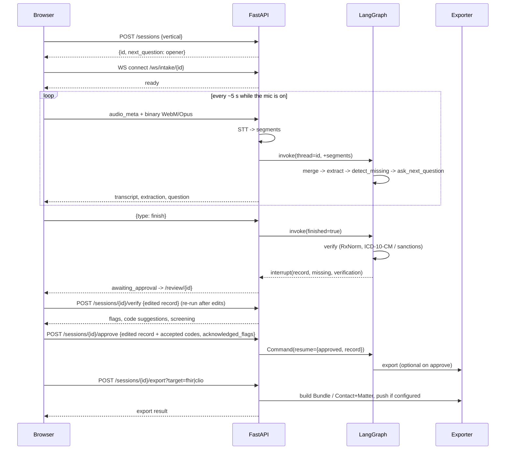

# IntakeAgent

**Voice-first AI intake for clinics and law firms.** Patients and clients talk; the agent
listens, asks the follow-ups a good intake coordinator would, checks what it heard against
public reference data (RxNorm, ICD-10-CM, OFAC and UN sanctions lists), and produces clean
FHIR R4 records or a Clio-ready matter, with a human approving every record. PHI never leaves
your own inference box.

[](https://github.com/Hassan-Memon/intakeagent/actions/workflows/ci.yml)


> **Live demo: [intakeagent.hassan-memon.workers.dev](https://intakeagent.hassan-memon.workers.dev).**
> Choose a clinic or law-firm intake, play the sample patient or client (or type answers), then
> review the reference checks (the sample patient takes amoxicillin despite a penicillin allergy;
> the sample client's employer resembles an entry on a fictional sanctions list), approve and
> export a FHIR R4 bundle or Clio JSON. The backend is simulated in your
> browser, the people are fictional, and nothing you type leaves the page.

- **Talks, listens, follows up.** Browser microphone to WebSocket to Whisper; a LangGraph agent
  extracts a structured record and asks for whatever is still missing.
- **Two verticals, one engine.** `PatientIntake` (demographics, chief complaint, meds, allergies,
  insurance) and `LegalIntake` (client, matter, opposing party, key dates, conflict-check names).
- **Standards out, not PDFs.** FHIR R4 transaction Bundle (Patient, Encounter, Condition,
  AllergyIntolerance, MedicationStatement, Coverage) or Clio API v4 Contact + Matter.
- **Checked before anyone approves.** A `verify` step codes medications to RxNorm and flags any
  that conflict with a reported allergy by ingredient or drug class, suggests ICD-10-CM codes for
  the complaint and conditions (U.S. National Library of Medicine APIs, free, with a bundled
  offline snapshot), and screens every party in a legal intake against OFAC and UN sanctions
  lists **locally**. Suggestions only: the reviewer accepts codes, and approving past a flag is
  an audited acknowledgement. See [ADR-0007](docs/adr/ADR-0007-reference-data-verification.md).
- **Human in the loop by construction.** The graph parks on a LangGraph `interrupt()` until a
  person edits and approves. There is no code path that exports without approval.
- **Local-first PHI.** Default LLM is Ollama or an OpenInfer box tagged `private`. Any opt-in
  cloud call sees a regex-redacted transcript; placeholders are re-hydrated locally.
- **Runs with zero keys.** `DEMO_MODE=1` ships scripted speech, a rule-based extractor and mock
  exporters so `docker compose up` gives a full demo on a laptop.

## Architecture

```mermaid
flowchart LR
  subgraph Browser["Next.js 15 (Vercel free)"]
    Mic[MediaRecorder\n5s WebM/Opus segments] --> WS[WebSocket client]
    Review[Review form\nevidence tooltips]
  end
  subgraph Backend["FastAPI (Render free / Docker)"]
    WSE[/ws/intake/{id}/] --> STT{STT provider}
    STT -->|stub / Groq Whisper / faster-whisper| Graph
    subgraph Graph["LangGraph intake graph"]
      M[merge_transcript] --> E[extract] --> D[detect_missing]
      D -->|missing, not finished| Q[ask_next_question]
      D -->|finished| V[verify\nreference checks]
      V --> H[await_approval\ninterrupt]
      H --> X[export]
    end
    V -. drug names,\ncomplaint keywords .-> NLM[(NLM RxNav, RxClass,\nClinical Tables\nor bundled snapshot)]
    V -. matched locally .-> SL[(OFAC + UN\nsanctions lists)]
    E -. redact before\nnon-local LLM .-> LLM[(LLM\nOllama / OpenInfer / Groq)]
    Q -. protocol hint .-> RAG[(pgvector\nprotocol snippets)]
    REST[/REST: sessions, approve, export, records/]
  end
  X --> FHIR[(FHIR R4 server\nHAPI sandbox)]
  X --> Clio[(Clio API v4)]
  Backend --> PG[(Postgres + pgvector\nNeon free)]
  WS <--> WSE
  Review <--> REST
```

### A session, end to end



## Quickstart

### Option A: Docker, zero keys

```bash
cp .env.example .env
docker compose up --build
# frontend http://localhost:3000, backend http://127.0.0.1:8000/docs
```

Pick a vertical, press the microphone (or type), watch the record fill in, press
**Finish and review**, edit, **Approve**, **Export**. In demo mode each audio segment advances a
scripted conversation so the flow is identical with or without a real microphone.

### Option B: run the pieces locally

```bash
# backend (Python 3.12+, uv)
cd backend
uv sync
DEMO_MODE=1 uv run uvicorn intakeagent.main:app --reload --host 127.0.0.1 --port 8000
uv run pytest            # 69 tests, fully offline

# frontend (Node 22)
cd frontend
npm ci
cp .env.example .env.local
npm run dev              # http://localhost:3000
```

### Going live (still free)

| Capability | Setting | Notes |
| --- | --- | --- |
| Real speech-to-text, local | `uv sync --extra stt-local`, `STT_PROVIDER=faster_whisper` | CPU `base` model is roughly real time |
| Real speech-to-text, hosted | `STT_PROVIDER=groq`, `GROQ_API_KEY` | whisper-large-v3 on Groq's free tier; audio leaves your machine |
| LLM extraction, local | `DEMO_MODE=0`, `LLM_PROVIDER=ollama`, `LLM_MODEL=llama3.2` | `docker compose --profile local-llm up` |
| LLM via OpenInfer | `OPENINFER_BASE_URL=http://host:8080/v1` | requests carry the `private` tag |
| LLM, cloud (redacted) | `LLM_PROVIDER=groq`, `ALLOW_CLOUD_LLM=1` | transcript is redacted first |
| Push FHIR to HAPI sandbox | `FHIR_PUSH=1` | synthetic data only |
| Clio live | `CLIO_CLIENT_ID`, `CLIO_CLIENT_SECRET`, then visit `/oauth/clio/authorize` | set the returned `CLIO_ACCESS_TOKEN` |
| Clinical codes, live | `DEMO_MODE=0` (`TERMINOLOGY_PROVIDER=auto` or `nlm`) | NLM RxNav and Clinical Tables, no key; falls back to the bundled snapshot. Sends drug names and complaint keywords only; `offline` sends nothing |
| Sanctions screening, real lists | `cd backend && uv run python -m intakeagent.verify.sanctions refresh --out data/sanctions.json` | OFAC SDN, OFAC Consolidated and UN lists (~21,000 entries), matched locally; `SANCTIONS_LIST_PATH` points at the file. Refresh on a schedule |

## Free deployment guide

Everything below has a free tier at the time of writing. Nothing requires a card beyond what
the provider itself asks for.

1. **Database: Neon.** Create a project, enable the `vector` extension (`CREATE EXTENSION vector;`
   in the SQL editor, or let the app do it on first boot). Copy the connection string as
   `DATABASE_URL=postgresql+psycopg://...`.
2. **Backend: Render free web service.** New Web Service from this repo, root directory `backend`,
   runtime Docker (the `backend/Dockerfile` is multi-stage). Environment: `DATABASE_URL`,
   `DEMO_MODE=0` or `1`, `CORS_ORIGINS=https://<your-vercel-app>.vercel.app`,
   `STT_PROVIDER=groq` + `GROQ_API_KEY` for real speech. Free instances sleep after idle;
   the first request takes ~30 s.
3. **Speech-to-text: Groq.** Free API key at console.groq.com. Whisper-large-v3 is fast and
   accurate; see `docs/compliance.md` before sending real PHI anywhere.
4. **Frontend: Vercel.** Import the repo, root directory `frontend`. Environment variables
   `NEXT_PUBLIC_API_URL=https://<render-service>.onrender.com` and
   `NEXT_PUBLIC_WS_URL=wss://<render-service>.onrender.com`. Deploy.
5. **Optional local LLM.** Run Ollama on any machine you control (Oracle Always Free ARM works)
   and point `OLLAMA_BASE_URL` at it, or run OpenInfer and set `OPENINFER_BASE_URL`.

## Deploy to Cloudflare Workers (free)

Live demo: **https://intakeagent.hassan-memon.workers.dev**

The public demo is the frontend alone, built with `NEXT_PUBLIC_DEMO_MODE=1`. In that mode
`lib/api.ts` and `lib/ws.ts` talk to an in-browser simulation of the backend (`frontend/lib/demo`)
instead of FastAPI: a TypeScript port of the rule-based extractor fills fields with evidence
spans, the question picker asks for missing required fields in the same order and words as the
backend, the reference checks run on the same NLM snapshot and a fictional sanctions list
(`lib/demo/verify.ts`), and approve and export build a real-shaped FHIR R4 transaction Bundle or Clio Contact +
Matter JSON that you can download. State lives in `sessionStorage`, nothing is sent anywhere, and
every page shows a banner saying so. Speech-to-text needs the real backend, so the demo offers a
fictional sample patient or client to play instead. For the full stack, use `docker compose up`.

The worker is built with [OpenNext for Cloudflare](https://opennext.js.org/cloudflare) and fits
the Workers free plan (about 0.9 MiB gzipped against the 3 MiB limit, no KV, R2 or D1 needed).

```bash
cd frontend
npm ci
npx wrangler login          # once, opens the browser
npm run cf:preview          # build in demo mode and serve the worker locally on :8787
npm run cf:deploy           # build in demo mode and deploy the "intakeagent" worker
```

`cf:build` sets `NEXT_PUBLIC_DEMO_MODE=1` for that build only; `npm run build` and the Docker
image are unchanged and still talk to the real backend. Config lives in `frontend/wrangler.jsonc`
(worker name, `nodejs_compat`, static assets binding, `workers_dev`) and
`frontend/open-next.config.ts`. To check the bundle size before deploying:
`npx wrangler deploy --dry-run` after `npm run cf:build`.

## Repository map

```
backend/                 FastAPI + LangGraph service (uv, pytest, ruff)
  intakeagent/schemas    PatientIntake, LegalIntake, Extracted[T] with evidence
  intakeagent/graph      graph builder, extractors (rules + LLM), question picker
  intakeagent/redaction  regex PHI redaction and re-hydration
  intakeagent/stt        stub, Groq Whisper, faster-whisper
  intakeagent/llm        provider abstraction (OpenInfer, Ollama, Groq, Gemini, OpenRouter)
  intakeagent/verify     RxNorm/ICD-10-CM checks (NLM + snapshot), allergy flags, sanctions screening
  intakeagent/exporters  FHIR R4 Bundle, Clio Contact + Matter + OAuth2
  intakeagent/db         SQLModel tables, pgvector RAG, seed protocols
  intakeagent/api        REST, WebSocket, IntakeService
frontend/                Next.js 15 App Router + Tailwind 4
docs/
  protocol.md            WebSocket and REST contract
  compliance.md          HIPAA / GDPR / UAE PDPL / KSA PDPL mapping, does and does-not-yet
  positioning.md         who it is for and why it wins
  adr/                   architecture decision records (MADR)
  learn/                 teaching track for the concepts used here
```

## Documentation

- [docs/README.md](docs/README.md): a map of every document in this repository
- [WebSocket and REST protocol](docs/protocol.md)
- [Compliance notes](docs/compliance.md)
- [Positioning](docs/positioning.md)
- [Architecture decision records](docs/adr/)
- [Learn: architecture walkthrough](docs/learn/01-architecture-walkthrough.md),
  [system design trade-offs](docs/learn/02-system-design-tradeoffs.md),
  [concepts](docs/learn/03-concepts/), [interview talk track](docs/learn/04-interview-talk-track.md),
  [run it yourself](docs/learn/05-run-it-yourself.md)

## Status

MVP, version 0.1.0. See [CHANGELOG.md](CHANGELOG.md) for the full history. Working: full demo flow, 69 offline tests, FHIR Bundle validated with `fhir.resources` and
carrying reviewer-accepted RxNorm and ICD-10-CM codes, allergy cross-checks, local sanctions
screening,
Clio payloads in v4 shape with a mocked live path, HITL interrupt and resume, PHI redaction,
pgvector RAG with SQLite fallback. Not yet: authentication, encryption at rest beyond the
database provider, WebRTC transport, Presidio integration, production hardening. See
`docs/compliance.md` for the honest list.

## License

Apache-2.0. Copyright 2026 Hassan Memon.
